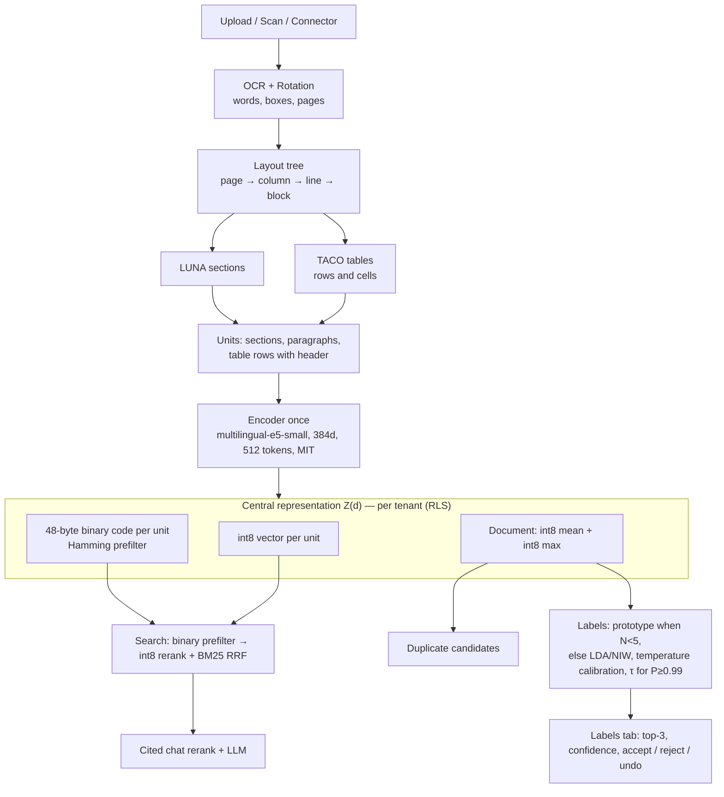

# Docuvate ML pipeline — current and target (Community Edition)

This document describes how document understanding flows through the API and worker today, and the target architecture after central per-tenant document representation (R1).

## One-sentence overview

The API (NestJS) accepts uploads and forwards bytes to the worker (FastAPI) at `POST /extract`. The worker runs an integrated CPU chain (OCR → rotation → LUNA → TACO → **single encode** → NEST → fields → KITE metadata). The API persists text, blocks, layout IR, and the **central representation** once. Labels, duplicates, search, chat, and SPARK read stored vectors and tenant state—no second encode on the document body.

## Target diagram

## Encoder and units

| Item | Choice |
|------|--------|
| Model | `intfloat/multilingual-e5-small` (MIT, 384 dimensions, 512 tokens) |
| Revision | `614241f622f53c4eeff9890bdc4f31cfecc418b3` (pinned in worker constants) |
| Prefixes | `passage: ` for document units, `query: ` for questions |
| Runtime | ONNX/int8 via fastembed when available; otherwise `sentence-transformers` on CPU |
| Units | LUNA sections/paragraphs and TACO table rows (row text prefixed with header) when layout is available; otherwise paragraph splits of OCR text. Fixed 320/64 character windows are used only when layout units are unavailable. |
| Spans | Each unit stores `page`, bounding box, `char_start`, `char_end`. |

## Storage format

| Layer | Format |
|-------|--------|
| Per unit | `vector_scale` (float) + 384-byte int8 vector (`bytea`) + 48-byte binary code `sign(R·z)` with fixed versioned rotation `R` |
| Per document | int8 mean and int8 elementwise max over unit float vectors (no extra encoder call) |
| Metadata | `encoder_id`, `encoder_revision`, `representation_version` |
| Tables | `document_representation`, `document_representation_unit` (tenant-scoped, RLS) |
| Retired JSONB embeddings | No longer written; `document_embeddings.embedding` and `document_text_chunks.embedding` are nullable |

## Label heads

| Stage | Rule |
|-------|------|
| Cold start | Prototype classifier while a label has fewer than 5 examples |
| Warm | LDA / NIW sufficient statistics from 5 examples onward (existing closed-form NEST) |
| Calibration | Per-tenant temperature (NLL on held-out own documents) and threshold τ for auto-assign at precision ≥ 0.99 |
| Product | Below τ: suggest only; at or above τ with calibrated precision: auto-assign |

Tenant statistics live in `tenant_label_prototype` and existing `embedding_density_*` tables, all under RLS.

## Tenant isolation

- Every representation, statistic, calibration, suggestion, and duplicate table carries `tenant_id NOT NULL`.
- PostgreSQL RLS policy: `tenant_id = current_setting('app.tenant_id')`.
- The API sets `app.tenant_id` inside tenant-scoped transactions (`withTenantPgClient`).
- The worker is stateless and receives only the calling tenant’s NIW/calibration payload on `/extract`.

## Licenses (models in this pipeline)

| Component | Model | License |
|-----------|--------|---------|
| Document encoder | `intfloat/multilingual-e5-small` @ `614241f622f53c4eeff9890bdc4f31cfecc418b3` | MIT |
| RAG reranker | `BAAI/bge-reranker-v2-m3-int8` | Apache-2.0 |
| Chat LLM (default) | Ollama `qwen2.5:1.5b` | Apache-2.0 |
| OCR (default) | PaddleOCR `german` | Apache-2.0 |
| NEST | NIW / Student-t (no weights) | — |

Non-permissive or research-only models are not used in the CE pipeline.

## Upload path (R1)

1. API loads tenant NIW state and calls worker `POST /extract` with `embeddingDensityState`.
2. Worker runs the integrated pipeline; **one** `embed_passages` batch covers all units.
3. API persists `document_representation` (+ units), then indexes search chunks from stored int8 vectors (no `/embed` on document text).
4. Post-OCR pipeline runs label suggestions using the stored document mean vector and NEST; NEST stage availability is `ok` when tenant state is present.

## Search and chat

1. BM25 / trigram candidates (unchanged).
2. Binary Hamming prefilter on chunk `binary_code` (top k₁).
3. int8 inner-product rerank on survivors.
4. RRF fusion with lexical ranks.
5. Cross-encoder rerank in worker (`/rag/retrieve`) for cited chat.

## Feedback

Label accept, reject, and undo flow through corrections into NEST `/correct` and SPARK propagation; representation is not re-encoded on correction.
