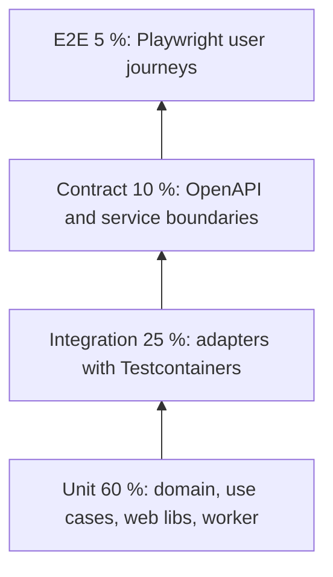

# Test strategy

Docuvate uses a test pyramid with measurable gates. Every layer of the Clean Architecture has a clear test type, and CI ratchets prevent coverage and code-health regressions.

## Test pyramid

Target shares (test cases and runtime budget): **unit 60 %**, **integration 25 %**, **contract 10 %**, **end-to-end 5 %**.

### What is tested where

| Level       | Location                         | Example                                         |
| ----------- | -------------------------------- | ----------------------------------------------- |
| Unit        | `apps/api/src/**/*.spec.ts`      | `UploadDocumentUseCase` with port fakes         |
| Unit        | `apps/web/src/**/*.spec.ts`      | `documentFilterQuery`, component rows           |
| Unit        | `apps/worker/tests/`             | Extraction and ML helpers (pytest)              |
| Integration | `apps/api/test/integration/`     | `PgFolderRepository` against PostgreSQL 18.6    |
| Integration | `apps/worker/tests/integration/` | Python Testcontainers fixtures                  |
| Contract    | `apps/api/test/contract/`        | Validate `openapi/docuvate.v1.json` and routes  |
| E2E         | `e2e/tests/`                     | Login, library, upload journeys with Playwright |

## Frameworks

| Area                   | Framework                                               |
| ---------------------- | ------------------------------------------------------- |
| API (`apps/api`)       | Vitest                                                  |
| Web (`apps/web`)       | Vitest, jsdom, Testing Library, i18n and literal checks |
| Worker (`apps/worker`) | pytest                                                  |
| SDKs                   | Vitest (Node), `dart test` (Flutter)                    |
| Design tokens          | Contrast test script (WCAG pairs)                       |
| Adapter integration    | Testcontainers (Node and Python)                        |
| End-to-end             | Playwright (`@docuvate/e2e`) against the Compose stack  |

## Architecture rules

- **Domain and application:** pure unit tests. No mocks of Nest, Fastify, better-auth, OTel, React, MinIO or Valkey. Dependencies go through port interfaces; tests use fakes or in-memory implementations.
- **Adapters (infrastructure):** integration tests with Testcontainers against real PostgreSQL 18.6, Valkey 8, MinIO, Mailpit and a lightweight Ollama HTTP stub (no model pull in PR pipelines).
- **Headless `/v1` API:** contract tests against the committed `openapi/docuvate.v1.json`.
- **Web:** component and hook tests with Testing Library; no E2E duplicates for pure UI logic.

## Testcontainers

| Service    | Node helper (`@docuvate/testing`) | Python fixture (`tests/integration/conftest.py`) |
| ---------- | --------------------------------- | ------------------------------------------------ |
| PostgreSQL | `startPostgresContainer()`        | `postgres_url`                                   |
| Valkey     | `startValkeyContainer()`          | `valkey_url`                                     |
| MinIO      | `startMinioContainer()`           | n/a                                              |
| Mailpit    | `startMailpitContainer()`         | `mailpit_smtp_url`                               |
| Ollama     | `startOllamaStubContainer()`      | n/a                                              |

Each adapter integration test:

1. Starts containers (session scope where possible).
2. Runs `runMigrations()` once per PostgreSQL instance.
3. Isolates data per test with synthetic users and cascading deletes.
4. Fails hard when Docker is not available.

Container images are pinned by digest (`image@sha256:...`) in `packages/testing/src/container-images.ts` and `docker-compose.yml`, byte-identical in both places. `:latest` is not allowed. `node scripts/testing/verify-container-images.mjs` checks this; Dependabot proposes digest updates.

## Cross-cutting topics

- **i18n:** `apps/web` test scripts check that every i18n key exists in German and English and that UI code contains no hard-coded literals.
- **Security:** ABAC integration tests (owner allowed, other users denied, service credentials without claim denied) and cross-tenant leak tests in `apps/api/test/integration/`.
- **ML quality:** golden sets use synthetic PDF and image fixtures only. Metrics (field F1, OCR character error rate, layout consistency) are checked against thresholds by the nightly model gates (`bench/model_gates`).
- **Migrations:** `db-migrate-fresh` runs every migration on an empty PostgreSQL 18.6 database and checks the TypeORM roundtrip.

## Test data

- Synthetic fixtures only (factories in `@docuvate/testing`).
- Invented names and the `@fixture.docuvate.test` domain.
- No real personal documents, IDs or payslips; sample documents are generated.
- Builder and factory patterns; no static UUIDs shared across tests.

## CI gates

### Pull requests

[`.github/workflows/ci.yml`](../../.github/workflows/ci.yml) runs on every pull request. Path filters skip jobs whose inputs did not change; `ci-ok` aggregates the result.

| Job                                  | Content                                                                        |
| ------------------------------------ | ------------------------------------------------------------------------------ |
| `quick-checks`                       | Banned tokens, conflict markers, SPDX headers, tool pins, manifests, SDK drift |
| `affected`                           | Nx affected lint, typecheck, unit tests with coverage, build                   |
| `worker-unit`                        | Worker lint and pytest unit tests                                              |
| `integration-test`                   | Testcontainers integration tests for API and worker                            |
| `db-migrate-fresh`                   | Migrations on an empty database                                                |
| `smoke`                              | Compose smoke profile with Playwright smoke                                    |
| `site-e2e`                           | Landing site Playwright tests                                                  |
| `go-sftp-ingest`, `sftp-integration` | SFTP ingest service build, tests and end-to-end                                |
| `kubernetes-manifests`               | Kustomize and Helm manifest validation                                         |

To run the same jobs locally, see [Local CI](../local-ci.md).

### Nightly

[`.github/workflows/nightly.yml`](../../.github/workflows/nightly.yml) runs slower suites that do not block merges: model gates, heavy lint, full Playwright journeys, Docker builds including the GPU worker, and a kind cluster smoke test.

### Ratchets

- **Coverage ratchet:** a run fails when `lines` drops more than 0.1 percentage points below [`coverage-baseline.json`](coverage-baseline.json) (`scripts/testing/coverage-ratchet.mjs`).
- **Doctor ratchet:** no nestjs-doctor, react-doctor or fastapi-doctor score may fall below [`doctor-baseline.json`](doctor-baseline.json) (`scripts/testing/doctor-ratchet.mjs`). Doctor CLI versions are pinned so scores stay comparable. The long-term target is a score of at least 95 for all three.

### Flaky tests

Do not retry flaky tests silently. Open an issue for each flaky test and fix or remove it within 14 days.

## Definition of done for pull requests

- Unit tests for new domain logic and use cases.
- Adapter changes come with a Testcontainers integration test, or the pull request explains why not.
- New UI logic has component tests; i18n keys exist in German and English.
- OpenAPI changes pass `pnpm openapi:check` and the contract tests.
- Doctor scores and coverage do not regress.
- Synthetic fixtures only.
