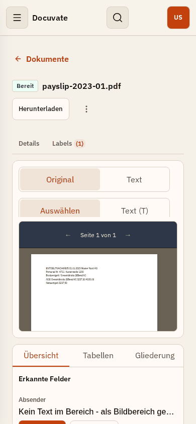
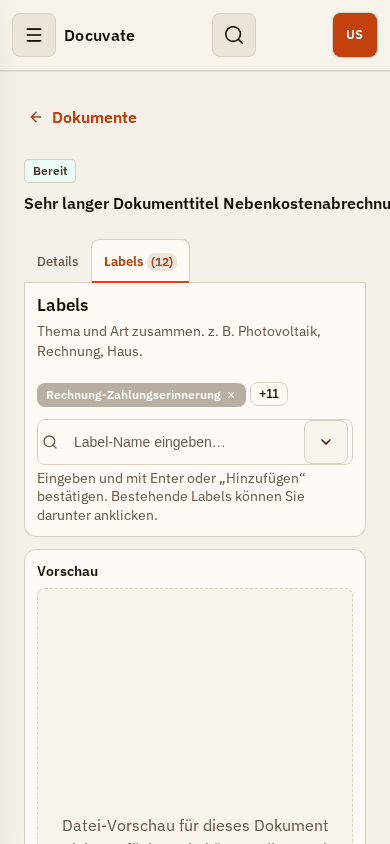
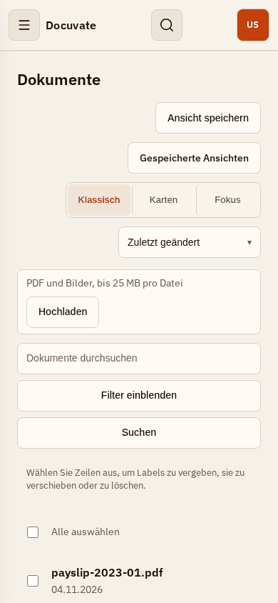
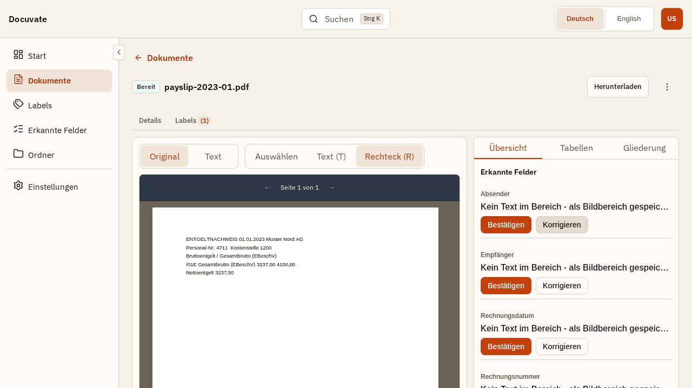
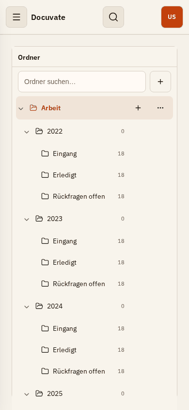
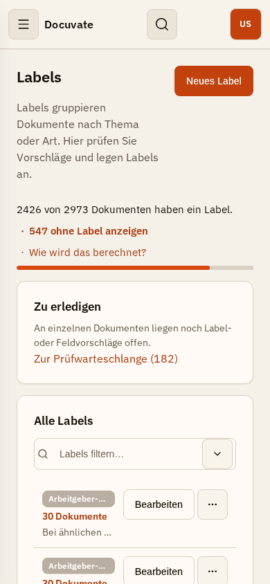
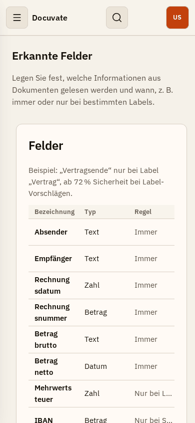
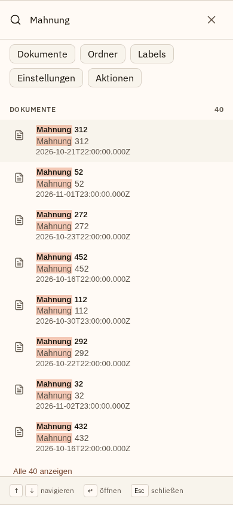

# Docuvate CE – UX audit at scale (2026-11-04)

Goal: the web UI must stay usable, efficient and self-explanatory with **hundreds of labels,
thousands of documents and dozens of recognized fields**, including on small screens.

## Method

- Local dev stack only (Docker infra + native API/web/worker), **synthetic fixture data only**.
- Fixture: `node tools/ux-metrics/seed-scale.mjs` (deterministic, seed 42) creates the user
  `ux.scale@fixture.docuvate.test` with 300 labels (every 9th with an over-long name), 3000 documents
  (long titles, 0–12 labels each, failed/processing states, suggestions), 30 recognized fields
  (6 "always", 10 shown in filters, label-gated rules) and 168 nested folders. Plus the repo's
  synthetic PDF fixtures uploaded and processed.
- Complements the report-only `tools/ux-metrics` budgets (small neutral seed) with a scale seed.
- Probe: `cd e2e && node scripts/ux-scale-audit.mjs <outDir>` visits every top-level page plus two
  document views at 1280×720, 1366×768, 1024×640 and 390×844 and records document-level overflow,
  DOM size, occluded controls (`elementFromPoint`), touch targets < 24 px, unnamed buttons, page
  errors and 5xx responses. Interactions (Korrigieren, Tabellen, Labels tab, Ctrl+K search) were
  probed manually with the same harness.

No page has document-level horizontal overflow and no button is unnamed. The problems are
composition problems: clipped toolbars inside `overflow: hidden`, stacked controls on mobile,
long flat lists and misleading correction states.

## Summary

| Priority | Meaning                             | Count |
| -------- | ----------------------------------- | ----- |
| P0       | blocks a use case                   | 5     |
| P1       | hurts efficiency / clarity at scale | 10    |
| P2       | polish                              | 6     |

## P0 – blocks use

| #    | Area                                 | Finding                                                                                                                                                                                                           | Fix                                                                                                                                           |
| ---- | ------------------------------------ | ----------------------------------------------------------------------------------------------------------------------------------------------------------------------------------------------------------------- | --------------------------------------------------------------------------------------------------------------------------------------------- |
| P0-1 | Document view – fields               | A field without a value shows "Kein Text im Bereich - als Bildbereich gespeichert" and offers **Bestätigen** – i.e. confirming an empty value. With 6–30 fields the panel is a wall of identical, wrong messages. | Empty rows say "Nicht gefunden" and offer "Im Dokument markieren" / "Wert eingeben"; no confirm for empty values.                             |
| P0-2 | Document view – correction           | **Korrigieren** silently switches the viewer to the rectangle tool. No instruction, no cancel, no way to type a value on desktop. Users don't know what to do next.                                               | Inline correction editor: text input + "Im Dokument markieren" + cancel, with a visible hint while the rectangle tool is armed (Esc cancels). |
| P0-3 | Document view – 390 px               | Viewer tool switch "Auswählen \| Text (T) \| Rechteck (R)" is clipped; **Rechteck is unreachable** (occluded). Viewer is ~150 px tall; the field panel stacks below the viewer.  | Toolbar wraps / icon-only on narrow screens; viewer and side panel become tabs ("Dokument" / "Felder") below 768 px.                          |
| P0-4 | Document header – 390 px             | Long titles do not wrap and are clipped; header actions get pushed out.                                                                                               | Title wraps (2 lines, full title in `title`), actions stay in a fixed slot.                                                                   |
| P0-5 | Document list / Posteingang – 390 px | Eight controls stack vertically (save view, saved views, view toggle, sort, upload, search, filter, search button); the **first document starts at ~800 px**, below the fold.   | Compact toolbar: search + filter button in one row, the rest in an overflow menu; upload as an icon button.                                   |

Correction flow on desktop after clicking "Korrigieren" (no hint, all rows say "Bildbereich"):

## P1 – efficiency at scale

| #     | Area                     | Finding                                                                                                                                                                                         |
| ----- | ------------------------ | ----------------------------------------------------------------------------------------------------------------------------------------------------------------------------------------------- |
| P1-1  | Document view – fields   | 30 fields in one flat list; no "Gefunden / Fehlt" grouping, no field filter. Field suggestions sit below all fields.                                                                            |
| P1-2  | Document list – filters  | Every `show_in_filter` field adds a stacked filter block (10 in the fixture); the sidebar becomes a long scroll. Date inputs show `mm/dd/yyyy` in the German UI.                                |
| P1-3  | Document list            | Titles truncated hard at 1280 px ("lohnsteuerbescheini…"); 21 touch targets < 24 px at 390 px.                                                                                                  |
| P1-4  | Ordner                   | Parent folders show count **0** although their subfolders hold 54 documents (direct count only).                                                                                                |
| P1-5  | Ordner – 390 px          | The folder tree fills the whole screen (page height 8 018 px); documents only after the full tree. Tree is not virtualized (~5 000 DOM nodes for 168 folders).  |
| P1-6  | Ordner – desktop         | Tree column ~200 px; names truncated ("Rückf…"), folder cards truncate ("Laufende V…").                                                                                                         |
| P1-7  | Labels – 390 px          | Label names truncated to ~12 characters ("Arbeitgeber-…"); rows with similar prefixes are indistinguishable.                                                     |
| P1-8  | Erkannte Felder – 390 px | 3-column table; field names break mid-word ("Rechnung sdatum"), rule column truncated ("Nur bei L…").                                                 |
| P1-9  | Suche (Ctrl+K)           | Dates shown as raw ISO (`2026-10-21T22:00:00.000Z`); title repeated as subtitle; no filename/folder context.                                                     |
| P1-10 | Prüfen                   | One suggestion per step with a "Nächste Seite" button; with 182 documents waiting this means hundreds of clicks. Bulk actions exist but sit next to the title.                                  |

## P2 – polish

| #    | Area                   | Finding                                                                                                                     |
| ---- | ---------------------- | --------------------------------------------------------------------------------------------------------------------------- |
| P2-1 | Start vs. Labels       | Counts disagree ("Mit Labels 2456 / Ohne Label 547" vs "2426 von 2973"). Different bases (all vs. ready) are not explained. |
| P2-2 | Document view – Labels | Hint mentions a "Hinzufügen" button that is not shown.                                                                      |
| P2-3 | Start                  | Top-label chips truncated at ~20 characters.                                                                                |
| P2-4 | Document without file  | "Datei-Vorschau nicht verfügbar" plus a large "Text erneut erkennen" primary button for a document that has no file.        |
| P2-5 | Labels tab             | Labels live in a separate tab on the document; on desktop they could sit in the header.                                     |
| P2-6 | Small targets          | Labels (18) and Ordner (20) at 390 px have many targets < 24 px.                                                            |

## Fix order

1. Document view and corrections (P0-1 … P0-4, P1-1) – shared primitives: responsive split pane
   that collapses into tabs, wrapping segmented toolbar, inline correction editor.
2. Labels (P1-7, P2-2).
3. Document list (P0-5, P1-2, P1-3), Ordner (P1-4 … P1-6), Suche (P1-9).

Each fix PR adds Playwright coverage at 390×844 and asserts no clipped primary action.
