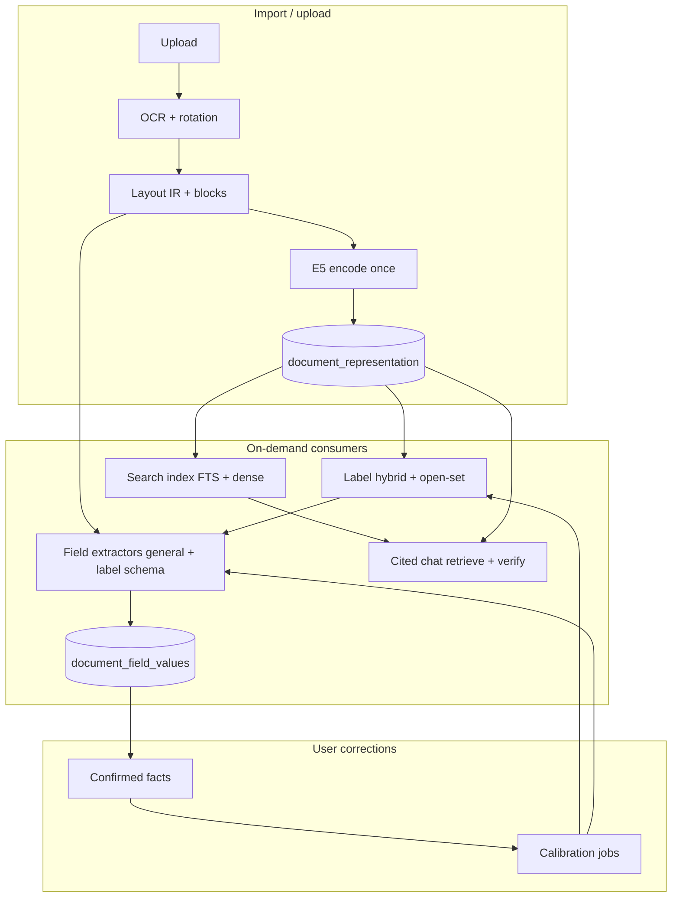

# Docuvate ML pipeline v0.1.0 — consolidated technical report

Research branch: `cursor/ml-pipeline-v010-2cc2`. Builds on extraction baseline (PR #90, branch `cursor/extraction-baseline-5a49`). **No production user data** in repo; public benchmarks (CORD, SROIE) are separated from **synthetic function tests** in CI (`apps/worker/tests`, `bench/model_gates`).

**Environment for new runs (this VM):** 4 vCPU Intel Xeon, CPU-only, ~16 GiB host RAM. Docker **not** available — cgroup `--cpus` / `--memory` replication deferred (use `research/extraction_baseline/scripts/run_in_cgroup.sh` when Docker exists).

---

## Executive summary

| Area | Finding | v0.1.0 action |
| --- | --- | --- |
| Central encoder | `intfloat/multilingual-e5-small` ONNX int8 @ `614241f622f53c4eeff9890bdc4f31cfecc418b3` (MIT) — keep | No change |
| Labels | TF-IDF + E5 + LR hybrid + open-set clustering — keep | No change |
| KV / fields | **GLiNER2-base** best measured zero-shot CPU baseline (F1 ~0.42); **layout KV head** and **DSRE** far below | Do **not** ship DSRE as extractor; defer GLiNER until gating + spans + positions; fix eval protocol only in research |
| GLiNER protocols | Legacy DSRE episode-level F1 (~0.17) **not comparable** to document-level F1 (~0.42) | **Unified protocol** in `lib/unified_gliner_protocol.py` |
| GLiNER2.5 | Wiring fixed (`batch_extract_entities` + spans/confidence). **multi-v1** beats base on SROIE F1 (0.50 vs 0.42); CORD still below base | No product PR; multilingual candidate only after layout offsets + calibration gates |
| Retrieval (MIRACL de dev) | **E5 dense alone** beats BM25 proxy and BM25+E5 RRF on nDCG@10 and source@1; logistic reranker on RRF candidates recovers most of E5 nDCG | Keep prod hybrid; do **not** replace dense with RRF-only; optional tiny reranker only if validated on tenant data |
| Chat (synthetic DE fixtures) | **Qwen3.5-4B Q4** (GGUF) higher faithfulness (0.60 vs 0.34) and ~3× lower latency than Qwen3-4B; Qwen3 over-abstains (94%) | Verify on maintainer Mac + real eval set; Qwen3.5 exists on HF as community GGUF (Apache-2.0 base) |
| Product PRs | No integration met precision + latency + license + RAM gates | **Research-only** this iteration |

---

## 1. Inventory — reuse existing functions

### 1.1 Stage A — document processing (once)

| Concern | Reuse (paths) |
| --- | --- |
| OCR + blocks | Worker `POST /extract` — `apps/worker/src/docuvate_worker/presentation/routes.py` |
| Layout IR | `domain/layout_ir.py` — pages, blocks, tables, `char_start` / `char_end` |
| Layout build | `infrastructure/layout/build.py`, renderers |
| CPU pipeline stages | `application/cpu_document_pipeline/` (LUNA, TACO, fields, KITE) |
| Post-OCR module ids | `application/post_ocr_pipeline.py` (aligned with API `DocumentPipelineModuleId`) |

**Mapping normalized model text → original positions:** `RepresentationUnit` stores page, bbox, `char_start`, `char_end` (`docs/ml-pipeline.md`). Layout IR blocks carry word boxes for overlay / verification.

### 1.2 Stage B — shared semantic representation (E5)

| Concern | Reuse |
| --- | --- |
| ONNX encoder | `infrastructure/onnx_e5_encoder.py` — mean pool + L2 norm, int8 graph |
| Prefixes | `domain/representation/constants.py` — `passage:` / `query:` |
| Single encode per upload | `domain/representation/encode.py` → `encode_units()` |
| API persistence | `document_representation`, `document_representation_unit` (RLS) |
| Embedding port | `EmbeddingPort` → worker `POST /embed` (`http-embedding.adapter.ts`) |
| Token hidden states | Available from ONNX `last_hidden_state` (probe: `extraction_baseline/results/e5_onnx_probe.json`) — **not** persisted in prod |

**Caching policy (target, largely implemented):**

- **Document / unit vectors:** written once on extract; search and labels read stored int8 units (no re-embed on read paths).
- **Query vectors:** computed per chat/search query; cache key = `(tenant_id, encoder_revision, normalized query text, input_type)`.
- **Invalidation:** `encoder_revision` mismatch → `GET /v1/settings/encoder-reindex` background jobs.
- **Tenant isolation:** RLS on all representation and label tables; worker stateless, tenant payload on `/extract` only.

Do **not** replace unit vectors with document mean for span-level tasks. Do **not** persist full token matrices unless a future experiment proves ROI within 4–8 GiB budgets.

### 1.3 Stage C — specialised models

| Task | Production today | Research baseline |
| --- | --- | --- |
| Labels | `label-hybrid-auto-match.ts`, `label-open-set-discovery.ts`, NIW/LDA | Unchanged |
| Global KV suggestions | `layout_kv_roles/suggestions.py` + `layout-kv-role-head.v1.json` | F1 ≈ 0 on SROIE; ~0.002 CORD |
| Label-attached fields | `label_custom_fields.py` → `/extract/label-fields` | Format validators on label lines (not ML classification) |
| RAG retrieve | Worker `/rag/retrieve` — Hamming + int8 + BM25 RRF + `BAAI/bge-reranker-v2-m3-int8` | `bench/rag_gate_calibrate.py` |
| Chat | Cited chat pipeline — intent/answer-type E5 prototypes + extractive reader + Ollama | `eval/chat_de/`, `bench/cited_chat_eval.py` |

### 1.4 Result / evidence contract (existing + gaps)

**Already in product shape:**

- `document_field_values` — normalized field index (3NF), search columns
- `document_recognized_field_extraction_attempt` — outcome, confidence, extractor version fingerprint
- `document_tag_suggestions` — label suggestions with `source`, confidence
- Cited chat — citation verification against chunk bodies

**Target contract (v0.1.0 design, incremental adoption):**

| Field | Source |
| --- | --- |
| doc + tenant ref | All tables `tenant_id`, `document_id` |
| model id / revision / config | `encoder_id`, `encoder_revision`, `RECOGNIZED_FIELD_EXTRACTOR_VERSION`, third-party manifest |
| predicted field / label | Field key, tag id |
| value + type | Typed format validators + ML suggestions |
| raw score + **calibrated** confidence | Separate tables per family; **never multiply** uncalibrated scores across models |
| source ref | page, bbox, char span from `RepresentationUnit` or layout block |
| status | suggested / confirmed / corrected / rejected / abstained |
| provenance | Which representation unit or OCR pass produced the input |

**Confirmed values:** writers must use upsert rules that reject ML overwrites of user-confirmed rows (existing recognized-field gate + document repository patterns).

---

## 2. Prior findings (PR #90) — consolidated

Detailed tables: `research/extraction_baseline/REPORT.md`, `research/extraction_baseline/dsre/REPORT.md`.

### 2.1 Models (commercial)

| Model | Revision / pin | License | SHA-256 (primary weight) |
| --- | --- | --- | --- |
| E5 small ONNX int8 | `614241f622f53c4eeff9890bdc4f31cfecc418b3` | MIT | `dd476dd0…` (`model_qint8_avx512_vnni.onnx`, see `model_manifest.json`) |
| GLiNER2-base | `f9634218e53580c56edf0de97ca1a7d3f1c2354e` | Apache-2.0 | `845fc4bd…` (`model.safetensors`) |

FUNSD / XFUND / DocVQA weights are **not** used.

### 2.2 Field extraction (public benchmark — **not** synthetic)

**Unified protocol** (this branch, reproduced on this VM): original dataset OCR lines, document-level micro-F1, one `batch_extract_entities` call per document.

| Dataset | GLiNER2-base F1 | P50 latency | P95 latency |
| --- | ---: | ---: | ---: |
| CORD test (n=100) | **0.425** | 71 ms | 104 ms |
| SROIE test (n=347) | **0.421** | 139 ms | 222 ms |

Artifacts: `results/unified_gliner2_base.json` (matches `extraction_baseline/results/benchmark_scores.json` GLiNER rows).

| Method | CORD F1 | SROIE F1 | Notes |
| --- | ---: | ---: | --- |
| GLiNER2-base (unified) | 0.425 | 0.421 | Best measured zero-shot |
| Docuvate layout KV | 0.002 | 0.000 | Role/link thresholds abstain on unseen templates |
| E5 token-span baseline | 0.077 | 0.051 | Ablation only |
| DSRE relational | 0.191 | 0.062 | Episode-level; below GLiNER |
| DSRE legacy GLiNER block | 0.346 | 0.169 | **Wrong protocol** — see §2.3 |

Peak RSS GLiNER loaded: ~2.2 GiB (`latency_rss.json`); unified full run peak ~11.6 GiB on this VM (includes HF datasets + torch).

### 2.3 GLiNER protocol reconciliation (resolved in research)

Legacy DSRE reported F1 ~0.17 / ~0.35 and latency ~2–3 s/doc vs ~0.42 F1 and ~70–140 ms in extraction baseline.

**Root causes** (see `results/gliner_protocol_reconciliation.json`):

1. **Scoring:** DSRE scored **one gold field per episode** (first span only), not full `canonical_gt` per document.
2. **Text:** DSRE rebuilt text from **deduplicated candidate lines** truncated to 3500 chars, not full OCR from HF builders.
3. **Latency:** Measured inside long-running DSRE process (train + matplotlib + per-doc loop); not a clean GLiNER micro-benchmark.

**Canonical protocol:** `research/ml_pipeline_v010/lib/unified_gliner_protocol.py` — all v0.1.0 comparisons must use this (or `extraction_baseline/scripts/run_benchmark.py`, which is equivalent for GLiNER2-base).

DSRE `gliner_eval` retains legacy behavior but tags `"protocol": "legacy_dsre_episode_level_npz_text"` for audit.

### 2.4 GLiNER2.5 — wiring fix + full public test (Round 2)

**Root cause (Round 1):** calling `AutoExtractor.extract(text, {label: desc})` returned empty `entities`. **Fix:** `batch_extract_entities(..., include_confidence=True, include_spans=True)` via `lib/field_extractor_backends.py` (same entity-type list as unified GLiNER2-base).

**Protocol:** unified original OCR, document-level micro-F1, isotonic calibration on CORD val / SROIE train, per-span precision–coverage CSVs, 500× bootstrap CIs, P50/P95 per-doc latency, peak RSS. Weights: `model.safetensors` SHA-256 in `results/field_extractor_suite.json`.

| Model | HF revision | CORD test F1 [95% CI] | SROIE test F1 [95% CI] | P50 ms (CORD / SROIE) | Peak RSS (MB) |
| --- | --- | --- | --- | --- | ---: |
| `gliner2-base-v1` | `f9634218…` | 0.425 [0.37–0.47] | 0.421 [0.40–0.44] | 70 / 141 | ~13539 |
| `gliner2.5-small-v1` | `df5910e4…` | 0.315 [0.27–0.37] | 0.300 [0.28–0.32] | 30 / 62 | ~14319 |
| `gliner2.5-base-v1` | `54785d51…` | 0.389 [0.34–0.44] | 0.447 [0.43–0.47] | 69 / 124 | ~14318 |
| `gliner2.5-multi-v1` | `cf5593a5…` | 0.371 [0.33–0.42] | **0.502** [0.48–0.52] | 68 / 161 | ~14150 |

**Negatives:** No 2.5 variant beats GLiNER2-base on **CORD**; small-v1 is clearly worse on both sets. Multilingual multi-v1 improves SROIE but adds ~1.1 GiB weights vs base and higher SROIE P95 (~282 ms). Subset probe after fix: non-zero F1 on 25 SROIE docs (`gliner25_sroie_probe.json`).

**Product:** still **no PR** — need layout `char_start`/`char_end` wiring, abstention policy on calibrated scores, and on-demand load under 8 GiB (single model peak ~14 GiB measured with HF datasets resident on this 16 GiB VM).

### 2.5 Hybrid retrieval — MIRACL German dev (public)

**Data:** `ir_datasets` `miracl/de/dev`; 3103 judged docs (qrels), 204 held-out queries; BM25 proxy over German tokenized text; dense = worker E5 int8 (`614241f622f53c4eeff9890bdc4f31cfecc418b3`, MIT, manifest in `retrieval_miracl_de.json`).

| Method | Recall@20 | nDCG@10 | Source correct @1 |
| --- | ---: | ---: | ---: |
| BM25 proxy | 0.882 | 0.458 | 0.279 |
| E5 dense only | **0.995** | **0.741** | **0.588** |
| BM25 + E5 RRF | 0.980 | 0.602 | 0.412 |
| RRF + logistic reranker (train queries) | 0.980 | 0.706 | 0.574 |

**Negative:** Plain RRF **hurts** rank quality vs E5 alone on this slice (likely because BM25 proxy is weak in German vs dense). Tiny reranker improves nDCG but does not beat pure E5 @1.

### 2.6 Chat — Qwen3-4B vs Qwen3.5-4B (synthetic, CPU llama.cpp)

**Not a public benchmark.** Fixture: `bench/model_gates/fixtures/chat_extractive_cases.json` (German, multi-doc, unanswerable). Identical evidence truncation (3500 chars), Q4_K_M GGUF, 4 threads, temperature 0.

| Model | GGUF source | Faithfulness | Abstention (`UNBEKANNT`) | P50 latency | Peak RSS |
| --- | --- | ---: | ---: | ---: | ---: |
| Qwen3-4B-Instruct-2507 | `lmstudio-community/Qwen3-4B-Instruct-2507-GGUF` | 0.34 | 0.94 | 16408 ms | ~5469 MB |
| Qwen3.5-4B-Instruct | `Hob-forge/Qwen3.5-4B-Instruct-GGUF` | **0.60** | 0.57 | **4840 ms** | ~5612 MB |

License: Qwen3 / Qwen3.5 base **Apache-2.0**; GGUF repacks per repo cards. Official Qwen HF GGUF for 3-4B was unavailable (404); used community mirror with same quant naming.

**Negative:** Qwen3 abstains on most cases (high precision on unanswerable but poor answerable faithfulness). Qwen3.5 answers more — monitor hallucination on real cited-chat eval.

### 2.7 Few-shot / incremental learning (public DSRE + synthetic labels)

**Field mapping (public):** DSRE relational head learning curves (full retrain per train fraction, no warm-start in `dsre_lib`) — `results/dsre_learning_curves_only.json`. CORD micro-F1 ~0.19 at all fractions; SROIE ~0.04–0.06 (far below GLiNER). Head metrics from PR #90 baseline: `results/dsre_few_shot/*_dsre_results.json` (copied from extraction baseline run).

**Labels (synthetic):** TF-IDF + E5 + LR proxy on `classification_texts.json` — holdout accuracy 1.0 at all shot counts (easy synthetic separation); incremental cumulative training matches full retrain; adding new label types did not change old-type holdout in this fixture (`few_shot_learning_curves.json`).

### 2.8 Resource limits without Docker

**Method:** `taskset` CPU affinity + `ulimit -v` virtual memory cap (`scripts/run_under_resource_limits.sh`); Python child RSS via `getrusage`.

| Profile | Result |
| --- | --- |
| 2 vCPU / 4 GiB ulimit | **Failed** — torch import / mmap GLiNER weights (`ImportError` / ENOMEM) |
| 4 vCPU / 8 GiB ulimit | **Failed** — safetensors mmap ~834 MB checkpoint failed under cap |

**Interpretation:** GLiNER2-base unified benchmark (30 docs) does **not** fit 4–8 GiB virtual caps as configured; aligns with §7 planning (on-demand load, no co-resident LLM).

---

## 3. Proposed modular pipeline (demand-driven graph)

**Execution rules:**

- **Import:** OCR → layout → **single** E5 encode → persist representation + search chunks.
- **Label suggestions:** read document mean / units + hybrid model; may **activate** label field schemas but must not block general extraction.
- **Field extraction:** run general schema + label-specific schema **in parallel**; wrong label must not suppress other fields.
- **Search:** reuse stored embeddings; optional reranker only if offline metrics improve Recall@20 / nDCG@10.
- **Chat:** retrieve → confirmed fields + spans → stats/extractive paths → LLM phrasing only; numbers from DB/stats code.
- **Corrections:** update confirmed store immediately (category A); queue incremental trainer jobs (category B) with batching rules.

Worker/API module ordering reference: `post_ocr_pipeline.py` descriptors vs API orchestration in `docs/document-processing-pipeline.md`.

---

## 4. Model choice per task (v0.1.0)

| Task | Model | License | In CE image? |
| --- | --- | --- | --- |
| Embeddings | `multilingual-e5-small` ONNX int8 | MIT | Yes (worker) |
| Labels | TF-IDF + E5 + LR (+ NIW/LDA) | — (no external weights) | Yes (API) |
| Layout KV | JSON head + E5 link/role | Docuvate artifact | Yes (worker) |
| Field zero-shot candidate | `fastino/gliner2-base-v1` | Apache-2.0 | **No** (research torch) |
| Field next candidate | `gliner2.5-multi-v1` | Apache-2.0 | **No** (eval pending) |
| Reranker | `bge-reranker-v2-m3-int8` | Apache-2.0 | Yes (worker) |
| Extractive QA | `xlm-roberta-base-squad2-distilled` | MIT | Yes (worker) |
| Chat LLM | `qwen2.5:1.5b` default; `qwen2.5:3b` optional | Apache-2.0 (Qwen2.5) | Optional Ollama profile |
| Chat upgrade path | `qwen3:4b` (Ollama Q4) | Apache-2.0 (Qwen3) | Needs `OLLAMA_MEM_LIMIT ≥ 5g` |
| Chat candidate (CPU GGUF) | `Qwen3.5-4B-Instruct` Q4_K_M | Apache-2.0 (Qwen3.5) | **Research** — beats Qwen3-4B on synthetic cited fixtures (§2.6) |
| OCR | PaddleOCR `german` | Apache-2.0 | Yes |

**Qwen3.5-4B:** Verified on Hugging Face as community GGUF (`Hob-forge/Qwen3.5-4B-Instruct-GGUF`); not pinned in CE/Ollama manifest yet. Prefer llama.cpp or Ollama once an official tag ships.

---

## 5. Learning lifecycle (A–D)

| Cat | Mechanism | v0.1.0 examples |
| --- | --- | --- |
| **A** Immediate | Corrections → stored facts, SQL stats, citation context | Label accept/reject; field confirm; no re-embed |
| **B** Incremental small models | Hybrid label retrain, routing prototypes, value-type heads | Batch by tenant when ≥N confirmed examples per class; LOO gates in `trainLabelHybridModel` |
| **C** Calibration | Temperature / τ for P≥0.99 labels; RAG gates from `bench/rag-gate-calibration-scores.json` | Separate cal vs confirm splits; report precision **and** coverage |
| **D** Fine-tune large | E5, GLiNER2.5, chat | **Blocked** until confirmed-volume ADR + independent test + CPU inference proof |

**Retrain triggers (non-exhaustive):** new confirmed examples, new labels/schemas, encoder revision, drift in open-set clusters, manual ops trigger, extractor fingerprint change (`recognized-field-extractor-fingerprint.ts`).

**Minimum data:** derive from learning curves on tenant data — do not ship hard-coded global minimums without measurement (DSRE used 0/20 confirm accepts → all gates ∞).

---

## 6. Versioning, activation, rollback

Align with `third-party-models.manifest.json` + model registry (`modules/model-registry`):

- Record: base model id, HF revision, dataset snapshot id (for benchmarks), training config hash, license, calibration blob version, quality metrics JSON.
- **Activation:** new extractor or encoder revision runs shadow eval vs incumbent; switch only if unified protocol F1 + latency + RAM criteria met on target hardware.
- **Rollback:** keep previous artifact JSON + encoder revision; reindex job reverses embedding revision.
- **Embeddings compatibility:** changing `encoder_revision` requires reindex; changing GLiNER does not invalidate E5 units.

---

## 7. CPU / RAM budget (2 vCPU / 4 GiB vs 4 vCPU / 8 GiB)

| Component | 4 GiB planning | 8 GiB planning |
| --- | --- | --- |
| Worker + E5 ONNX | ~0.9–1.2 GiB (`README.md`) | Same + headroom for OCR |
| GLiNER2-base (if ever co-loaded) | +~2.2 GiB peak — **exceeds 4 GiB** alone | Fits with on-demand load/unload |
| Ollama `qwen2.5:1.5b` | +~1.5 GiB | Optional profile |
| Ollama `qwen3:4b` | **Not recommended** | ≥5 GiB limit |

**Tactics:** on-demand GLiNER load; serialise heavy jobs; `DOCUVATE_ENCODER_INTRA_OP_THREADS=2` on 2 vCPU; chat lower priority queue; avoid co-resident GLiNER + 4B LLM on 8 GiB.

Measured E5 single passage: ~22 ms median (`latency_rss.json`). Unified GLiNER: 71–139 ms median per receipt doc.

---

## 8. Experiments status

| Experiment | Status | Artifact |
| --- | --- | --- |
| Fields GLiNER2-base unified | **Done** (full test splits) | `unified_gliner2_base.json` |
| Fields GLiNER2 / 2.5 suite | **Done** (4 models, calibration + bootstrap) | `field_extractor_suite.json`, `results/pc/*.csv` |
| Fields GLiNER2.5 probe | **Fixed wiring** | `gliner25_sroie_probe.json` |
| Fields layout KV / DSRE | **From PR #90** | `benchmark_scores.json`, `core_benchmark_summary.json` |
| Retrieval MIRACL de dev | **Done** (BM25 proxy, E5, RRF, reranker) | `retrieval_miracl_de.json` |
| Chat Qwen3 vs Qwen3.5 GGUF | **Done** (synthetic fixtures) | `chat_llamacpp_qwen3_compare.json` |
| Few-shot curves | **Done** (DSRE fractions + label proxy) | `few_shot_learning_curves.json`, `dsre_learning_curves_only.json` |
| CPU/RAM ulimit profiles | **Done** (failures documented) | `resource_limits.json` |
| Docker 4CPU/8GiB cgroup | **Skipped** (no Docker) | `run_in_cgroup.sh` |

**Synthetic vs public:** CI unit tests for `label_custom_fields`, layout KV, hybrid labels are **not** benchmark substitutes. All tables in §2.2 are **public dataset** runs.

---

## 9. Calibration and abstention

- **Labels:** hybrid cosine gates + `confidenceThreshold`; target precision 0.99 at τ (`docs/ml-pipeline.md`).
- **Layout KV:** link/role mins in artifact JSON — on SROIE produced **no** accepted pairs (zero coverage); high precision at zero coverage is **failure**, not success.
- **GLiNER2:** base checkpoint still lacks usable per-span scores in the unified API path used for GLiNER2-base.
- **GLiNER2.5:** per-span confidences available; isotonic calibration on val/train splits in `run_field_extractor_suite.py` — use calibrated scores for precision–coverage gates (CSV under `results/pc/`).
- **RAG:** fused score gates (`RAG_RERANKER_GATE_MIN`, dense floor 0.75).
- **Chat:** extractive path without LLM when possible; citation verification mandatory.

---

## 10. v0.1.0 prioritisation

1. **Keep** E5-central representation, hybrid labels, hybrid search, cited chat architecture.
2. **Standardise** field benchmark protocol (`unified_gliner_protocol.py`) for any future extractor PR.
3. **Do not integrate** GLiNER2-base until: span offsets into layout IR, calibrated abstention, CPU RAM budget with on-demand load, and F1/coverage on maintainer real docs — public F1 ~0.42 is insufficient alone for auto-confirm.
4. **Deprioritise** DSRE as primary extractor; optional rerank behind GLiNER not justified by PR #90 scores.
5. **Replace or retrain** layout KV head only with measured uplift on unified protocol + tenant-safe data — current head fails open on SROIE.
6. **GLiNER2.5-multi-v1** — best SROIE F1 in Round 2; integrate only with layout offsets + RAM gates; do not ship for CORD-dominated workloads without re-measurement.
7. **Chat:** promote **Qwen3.5-4B** GGUF/Ollama path after real cited-chat eval; Qwen3-4B over-abstains on synthetic fixtures.
8. **Retrieval:** prod hybrid unchanged; offline MIRACL de shows RRF-only is **not** an upgrade over dense E5 — any new reranker must beat E5 dense on tenant-safe data.
9. **Evidence contract:** extend extraction attempts with layout source refs when GLiNER or layout KV returns spans.

---

## 11. Open risks

- **SROIE license** — not SPDX on HF; commercial use requires ICDAR/RRC confirmation.
- **GLiNER torch dependency** — worker image size and RAM; not in default CE.
- **GLiNER2.5** — Round 1 empty entities were an integration bug (fixed); multi-v1 can beat base on SROIE but not CORD; peak RSS ~14 GiB with datasets loaded.
- **VM RAM** — run heavy benchmarks **sequentially** (GLiNER + DSRE + llama.cpp); parallel jobs OOM-killed on 16 GiB host.
- **Layout KV generalisation** — trained on CORD-like synthetic layouts; zero-shot SROIE failure expected without retrain.
- **Label-attached fields** — deterministic label-line parsing; not comparable to GLiNER schema extraction.
- **Real-document validation** — maintainer Mac instance (out of scope here); use `bench_docuvate_api.py` for read-only API smoke.

---

## 12. Product PR decision (this iteration)

**No product code PRs opened.** Measured benchmarks do not show a safe, bounded change that improves production metrics without GLiNER integration, new calibration, or layout KV retrain. Research deliverables: this report, unified protocol library, reconciliation artifacts, optional API smoke script.

---

## Appendix A — commands

See `research/ml_pipeline_v010/README.md`.

## Appendix B — cross-references

- Architecture: `docs/ml-pipeline.md`, `docs/document-processing-pipeline.md`
- Models: `THIRD_PARTY_MODELS.md`, `third-party-models.manifest.json`
- Extraction baseline: `research/extraction_baseline/REPORT.md`
- DSRE: `research/extraction_baseline/dsre/REPORT.md`

*Report generated on branch `cursor/ml-pipeline-v010-2cc2`. Measured JSON under `research/ml_pipeline_v010/results/`.*
