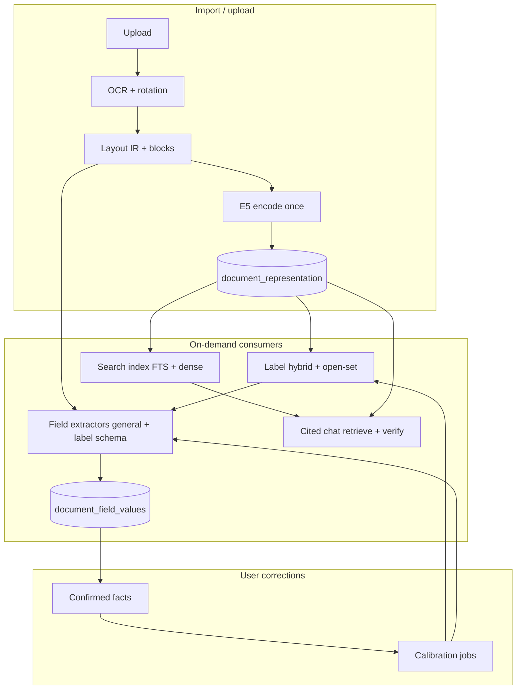

# Docuvate ML pipeline v0.1.0 — consolidated technical report

Research branch: `cursor/ml-pipeline-v010-2cc2`. Builds on extraction baseline (PR #90, branch `cursor/extraction-baseline-5a49`). **No production user data** in repo; public benchmarks (CORD, SROIE) are separated from **synthetic function tests** in CI (`apps/worker/tests`, `bench/model_gates`).

**Environment for new runs (this VM):** 4 vCPU Intel Xeon, CPU-only, ~16 GiB host RAM. Docker **not** available — cgroup `--cpus` / `--memory` replication deferred (use `research/extraction_baseline/scripts/run_in_cgroup.sh` when Docker exists).

---

## Executive summary

| Area | Finding | v0.1.0 action |
| --- | --- | --- |
| Central encoder | `intfloat/multilingual-e5-small` ONNX int8 @ `614241f622f53c4eeff9890bdc4f31cfecc418b3` (MIT) — keep | No change |
| Labels | TF-IDF + E5 + LR hybrid + open-set clustering — keep | No change |
| KV / fields | **GLiNER2-base** best measured zero-shot CPU baseline (F1 ~0.42); **layout KV head** and **DSRE** far below | Do **not** ship DSRE as extractor; defer GLiNER until gating + spans + positions; fix eval protocol only in research |
| GLiNER protocols | Legacy DSRE episode-level F1 (~0.17) **not comparable** to document-level F1 (~0.42) | **Unified protocol** in `lib/unified_gliner_protocol.py` |
| GLiNER2.5 | Apache-2.0 checkpoints exist; pilot `AutoExtractor` wiring returned empty entities on SROIE — **not ready** | Re-run with correct schema API before product decision |
| Retrieval | Hybrid BM25 + int8 E5 + RRF + BGE reranker already in product | Optional learnable reranker only after Recall@20 / nDCG@10 harness on tenant-safe data |
| Chat | CE default `qwen2.5:1.5b` / optional `qwen2.5:3b`; `qwen3:4b` needs ≥5 GiB Ollama limit | Compare Qwen3-family on maintainer Mac; document in `docs/ai-models.md` |
| Product PRs | No integration met precision + latency + license + RAM gates | **Research-only** this iteration |

---

## 1. Inventory — reuse existing functions

### 1.1 Stage A — document processing (once)

| Concern | Reuse (paths) |
| --- | --- |
| OCR + blocks | Worker `POST /extract` — `apps/worker/src/docuvate_worker/presentation/routes.py` |
| Layout IR | `domain/layout_ir.py` — pages, blocks, tables, `char_start` / `char_end` |
| Layout build | `infrastructure/layout/build.py`, renderers |
| CPU pipeline stages | `application/cpu_document_pipeline/` (LUNA, TACO, fields, KITE) |
| Post-OCR module ids | `application/post_ocr_pipeline.py` (aligned with API `DocumentPipelineModuleId`) |

**Mapping normalized model text → original positions:** `RepresentationUnit` stores page, bbox, `char_start`, `char_end` (`docs/ml-pipeline.md`). Layout IR blocks carry word boxes for overlay / verification.

### 1.2 Stage B — shared semantic representation (E5)

| Concern | Reuse |
| --- | --- |
| ONNX encoder | `infrastructure/onnx_e5_encoder.py` — mean pool + L2 norm, int8 graph |
| Prefixes | `domain/representation/constants.py` — `passage:` / `query:` |
| Single encode per upload | `domain/representation/encode.py` → `encode_units()` |
| API persistence | `document_representation`, `document_representation_unit` (RLS) |
| Embedding port | `EmbeddingPort` → worker `POST /embed` (`http-embedding.adapter.ts`) |
| Token hidden states | Available from ONNX `last_hidden_state` (probe: `extraction_baseline/results/e5_onnx_probe.json`) — **not** persisted in prod |

**Caching policy (target, largely implemented):**

- **Document / unit vectors:** written once on extract; search and labels read stored int8 units (no re-embed on read paths).
- **Query vectors:** computed per chat/search query; cache key = `(tenant_id, encoder_revision, normalized query text, input_type)`.
- **Invalidation:** `encoder_revision` mismatch → `GET /v1/settings/encoder-reindex` background jobs.
- **Tenant isolation:** RLS on all representation and label tables; worker stateless, tenant payload on `/extract` only.

Do **not** replace unit vectors with document mean for span-level tasks. Do **not** persist full token matrices unless a future experiment proves ROI within 4–8 GiB budgets.

### 1.3 Stage C — specialised models

| Task | Production today | Research baseline |
| --- | --- | --- |
| Labels | `label-hybrid-auto-match.ts`, `label-open-set-discovery.ts`, NIW/LDA | Unchanged |
| Global KV suggestions | `layout_kv_roles/suggestions.py` + `layout-kv-role-head.v1.json` | F1 ≈ 0 on SROIE; ~0.002 CORD |
| Label-attached fields | `label_custom_fields.py` → `/extract/label-fields` | Format validators on label lines (not ML classification) |
| RAG retrieve | Worker `/rag/retrieve` — Hamming + int8 + BM25 RRF + `BAAI/bge-reranker-v2-m3-int8` | `bench/rag_gate_calibrate.py` |
| Chat | Cited chat pipeline — intent/answer-type E5 prototypes + extractive reader + Ollama | `eval/chat_de/`, `bench/cited_chat_eval.py` |

### 1.4 Result / evidence contract (existing + gaps)

**Already in product shape:**

- `document_field_values` — normalized field index (3NF), search columns
- `document_recognized_field_extraction_attempt` — outcome, confidence, extractor version fingerprint
- `document_tag_suggestions` — label suggestions with `source`, confidence
- Cited chat — citation verification against chunk bodies

**Target contract (v0.1.0 design, incremental adoption):**

| Field | Source |
| --- | --- |
| doc + tenant ref | All tables `tenant_id`, `document_id` |
| model id / revision / config | `encoder_id`, `encoder_revision`, `RECOGNIZED_FIELD_EXTRACTOR_VERSION`, third-party manifest |
| predicted field / label | Field key, tag id |
| value + type | Typed format validators + ML suggestions |
| raw score + **calibrated** confidence | Separate tables per family; **never multiply** uncalibrated scores across models |
| source ref | page, bbox, char span from `RepresentationUnit` or layout block |
| status | suggested / confirmed / corrected / rejected / abstained |
| provenance | Which representation unit or OCR pass produced the input |

**Confirmed values:** writers must use upsert rules that reject ML overwrites of user-confirmed rows (existing recognized-field gate + document repository patterns).

---

## 2. Prior findings (PR #90) — consolidated

Detailed tables: `research/extraction_baseline/REPORT.md`, `research/extraction_baseline/dsre/REPORT.md`.

### 2.1 Models (commercial)

| Model | Revision / pin | License | SHA-256 (primary weight) |
| --- | --- | --- | --- |
| E5 small ONNX int8 | `614241f622f53c4eeff9890bdc4f31cfecc418b3` | MIT | `dd476dd0…` (`model_qint8_avx512_vnni.onnx`, see `model_manifest.json`) |
| GLiNER2-base | `f9634218e53580c56edf0de97ca1a7d3f1c2354e` | Apache-2.0 | `845fc4bd…` (`model.safetensors`) |

FUNSD / XFUND / DocVQA weights are **not** used.

### 2.2 Field extraction (public benchmark — **not** synthetic)

**Unified protocol** (this branch, reproduced on this VM): original dataset OCR lines, document-level micro-F1, one `batch_extract_entities` call per document.

| Dataset | GLiNER2-base F1 | P50 latency | P95 latency |
| --- | ---: | ---: | ---: |
| CORD test (n=100) | **0.425** | 71 ms | 104 ms |
| SROIE test (n=347) | **0.421** | 139 ms | 222 ms |

Artifacts: `results/unified_gliner2_base.json` (matches `extraction_baseline/results/benchmark_scores.json` GLiNER rows).

| Method | CORD F1 | SROIE F1 | Notes |
| --- | ---: | ---: | --- |
| GLiNER2-base (unified) | 0.425 | 0.421 | Best measured zero-shot |
| Docuvate layout KV | 0.002 | 0.000 | Role/link thresholds abstain on unseen templates |
| E5 token-span baseline | 0.077 | 0.051 | Ablation only |
| DSRE relational | 0.191 | 0.062 | Episode-level; below GLiNER |
| DSRE legacy GLiNER block | 0.346 | 0.169 | **Wrong protocol** — see §2.3 |

Peak RSS GLiNER loaded: ~2.2 GiB (`latency_rss.json`); unified full run peak ~11.6 GiB on this VM (includes HF datasets + torch).

### 2.3 GLiNER protocol reconciliation (resolved in research)

Legacy DSRE reported F1 ~0.17 / ~0.35 and latency ~2–3 s/doc vs ~0.42 F1 and ~70–140 ms in extraction baseline.

**Root causes** (see `results/gliner_protocol_reconciliation.json`):

1. **Scoring:** DSRE scored **one gold field per episode** (first span only), not full `canonical_gt` per document.
2. **Text:** DSRE rebuilt text from **deduplicated candidate lines** truncated to 3500 chars, not full OCR from HF builders.
3. **Latency:** Measured inside long-running DSRE process (train + matplotlib + per-doc loop); not a clean GLiNER micro-benchmark.

**Canonical protocol:** `research/ml_pipeline_v010/lib/unified_gliner_protocol.py` — all v0.1.0 comparisons must use this (or `extraction_baseline/scripts/run_benchmark.py`, which is equivalent for GLiNER2-base).

DSRE `gliner_eval` retains legacy behavior but tags `"protocol": "legacy_dsre_episode_level_npz_text"` for audit.

### 2.4 GLiNER2.5 pilot (subset, pending)

| Model | SROIE n=15 F1 | P50 latency | Status |
| --- | ---: | ---: | --- |
| `fastino/gliner2.5-small-v1` | 0.0 | 1470 ms | `AutoExtractor.extract` returned `{}` with simple entity schema — API/schema mismatch |
| `fastino/gliner2.5-base-v1` | 0.0 | 2482 ms | Same |

License: Apache-2.0. Loader: **`AutoExtractor`**, not `GLiNER2.from_pretrained` (per HF card).

**Next test:** follow GLiNER2.5 record/entity schema examples from Fastino docs; compare multilingual `gliner2.5-multi-v1` on German receipts (maintainer Mac + full split). **No product PR** until F1 beats 0.42 with calibrated abstention and span positions.

---

## 3. Proposed modular pipeline (demand-driven graph)

**Execution rules:**

- **Import:** OCR → layout → **single** E5 encode → persist representation + search chunks.
- **Label suggestions:** read document mean / units + hybrid model; may **activate** label field schemas but must not block general extraction.
- **Field extraction:** run general schema + label-specific schema **in parallel**; wrong label must not suppress other fields.
- **Search:** reuse stored embeddings; optional reranker only if offline metrics improve Recall@20 / nDCG@10.
- **Chat:** retrieve → confirmed fields + spans → stats/extractive paths → LLM phrasing only; numbers from DB/stats code.
- **Corrections:** update confirmed store immediately (category A); queue incremental trainer jobs (category B) with batching rules.

Worker/API module ordering reference: `post_ocr_pipeline.py` descriptors vs API orchestration in `docs/document-processing-pipeline.md`.

---

## 4. Model choice per task (v0.1.0)

| Task | Model | License | In CE image? |
| --- | --- | --- | --- |
| Embeddings | `multilingual-e5-small` ONNX int8 | MIT | Yes (worker) |
| Labels | TF-IDF + E5 + LR (+ NIW/LDA) | — (no external weights) | Yes (API) |
| Layout KV | JSON head + E5 link/role | Docuvate artifact | Yes (worker) |
| Field zero-shot candidate | `fastino/gliner2-base-v1` | Apache-2.0 | **No** (research torch) |
| Field next candidate | `gliner2.5-multi-v1` | Apache-2.0 | **No** (eval pending) |
| Reranker | `bge-reranker-v2-m3-int8` | Apache-2.0 | Yes (worker) |
| Extractive QA | `xlm-roberta-base-squad2-distilled` | MIT | Yes (worker) |
| Chat LLM | `qwen2.5:1.5b` default; `qwen2.5:3b` optional | Apache-2.0 (Qwen2.5) | Optional Ollama profile |
| Chat upgrade path | `qwen3:4b` (Ollama Q4) | Apache-2.0 (Qwen3) | Needs `OLLAMA_MEM_LIMIT ≥ 5g` |
| OCR | PaddleOCR `german` | Apache-2.0 | Yes |

**Qwen3.5-4B:** No pinned Ollama artifact in repo at report time; treat as **follow-up** after verifying tag existence and license on [ollama.com/library](https://ollama.com/library). Prefer documented `qwen3:4b` for CE experiments (`docs/ai-models.md`, `experiments/scripts/eval_cpu_docqa_models.py` when present on branch).

---

## 5. Learning lifecycle (A–D)

| Cat | Mechanism | v0.1.0 examples |
| --- | --- | --- |
| **A** Immediate | Corrections → stored facts, SQL stats, citation context | Label accept/reject; field confirm; no re-embed |
| **B** Incremental small models | Hybrid label retrain, routing prototypes, value-type heads | Batch by tenant when ≥N confirmed examples per class; LOO gates in `trainLabelHybridModel` |
| **C** Calibration | Temperature / τ for P≥0.99 labels; RAG gates from `bench/rag-gate-calibration-scores.json` | Separate cal vs confirm splits; report precision **and** coverage |
| **D** Fine-tune large | E5, GLiNER2.5, chat | **Blocked** until confirmed-volume ADR + independent test + CPU inference proof |

**Retrain triggers (non-exhaustive):** new confirmed examples, new labels/schemas, encoder revision, drift in open-set clusters, manual ops trigger, extractor fingerprint change (`recognized-field-extractor-fingerprint.ts`).

**Minimum data:** derive from learning curves on tenant data — do not ship hard-coded global minimums without measurement (DSRE used 0/20 confirm accepts → all gates ∞).

---

## 6. Versioning, activation, rollback

Align with `third-party-models.manifest.json` + model registry (`modules/model-registry`):

- Record: base model id, HF revision, dataset snapshot id (for benchmarks), training config hash, license, calibration blob version, quality metrics JSON.
- **Activation:** new extractor or encoder revision runs shadow eval vs incumbent; switch only if unified protocol F1 + latency + RAM criteria met on target hardware.
- **Rollback:** keep previous artifact JSON + encoder revision; reindex job reverses embedding revision.
- **Embeddings compatibility:** changing `encoder_revision` requires reindex; changing GLiNER does not invalidate E5 units.

---

## 7. CPU / RAM budget (2 vCPU / 4 GiB vs 4 vCPU / 8 GiB)

| Component | 4 GiB planning | 8 GiB planning |
| --- | --- | --- |
| Worker + E5 ONNX | ~0.9–1.2 GiB (`README.md`) | Same + headroom for OCR |
| GLiNER2-base (if ever co-loaded) | +~2.2 GiB peak — **exceeds 4 GiB** alone | Fits with on-demand load/unload |
| Ollama `qwen2.5:1.5b` | +~1.5 GiB | Optional profile |
| Ollama `qwen3:4b` | **Not recommended** | ≥5 GiB limit |

**Tactics:** on-demand GLiNER load; serialise heavy jobs; `DOCUVATE_ENCODER_INTRA_OP_THREADS=2` on 2 vCPU; chat lower priority queue; avoid co-resident GLiNER + 4B LLM on 8 GiB.

Measured E5 single passage: ~22 ms median (`latency_rss.json`). Unified GLiNER: 71–139 ms median per receipt doc.

---

## 8. Experiments status

| Experiment | Status | Artifact |
| --- | --- | --- |
| Fields GLiNER2-base unified | **Done** (full test splits) | `unified_gliner2_base.json` |
| Fields GLiNER2.5 | **Pilot failed** (API) | `gliner25_sroie_probe.json` |
| Fields layout KV / DSRE | **From PR #90** | `benchmark_scores.json`, `core_benchmark_summary.json` |
| Retrieval reranker ablation | **Not re-run** (existing CE hybrid + BGE) | `bench/rag_gate_calibrate.py` |
| Chat Qwen3 vs Qwen2.5 | **Documented**, not re-run on this VM | `docs/ai-models.md` |
| Continuous learning curves | **Skipped** (runtime cap per DSRE report) | `run_dsre_benchmark.py` optional |
| Docker 4CPU/8GiB | **Skipped** (no Docker) | `run_in_cgroup.sh` |

**Synthetic vs public:** CI unit tests for `label_custom_fields`, layout KV, hybrid labels are **not** benchmark substitutes. All tables in §2.2 are **public dataset** runs.

---

## 9. Calibration and abstention

- **Labels:** hybrid cosine gates + `confidenceThreshold`; target precision 0.99 at τ (`docs/ml-pipeline.md`).
- **Layout KV:** link/role mins in artifact JSON — on SROIE produced **no** accepted pairs (zero coverage); high precision at zero coverage is **failure**, not success.
- **GLiNER2:** public API lacks per-span scores in `batch_extract_entities` — abstention requires logit-level API or GLiNER2.5 scores; until then treat all spans as suggestions with confidence **unknown**, gate in UI at confirm-only.
- **RAG:** fused score gates (`RAG_RERANKER_GATE_MIN`, dense floor 0.75).
- **Chat:** extractive path without LLM when possible; citation verification mandatory.

---

## 10. v0.1.0 prioritisation

1. **Keep** E5-central representation, hybrid labels, hybrid search, cited chat architecture.
2. **Standardise** field benchmark protocol (`unified_gliner_protocol.py`) for any future extractor PR.
3. **Do not integrate** GLiNER2-base until: span offsets into layout IR, calibrated abstention, CPU RAM budget with on-demand load, and F1/coverage on maintainer real docs — public F1 ~0.42 is insufficient alone for auto-confirm.
4. **Deprioritise** DSRE as primary extractor; optional rerank behind GLiNER not justified by PR #90 scores.
5. **Replace or retrain** layout KV head only with measured uplift on unified protocol + tenant-safe data — current head fails open on SROIE.
6. **GLiNER2.5-multi** evaluation after fixing AutoExtractor schema — candidate for multilingual receipts/invoices.
7. **Chat:** run `eval_cpu_docqa_models.py` on maintainer hardware for `qwen3:4b` vs `qwen2.5:3b` with identical evidence contexts.
8. **Retrieval:** add offline Recall@20 / nDCG@10 harness wired to stored `document_representation_unit` before any learnable reranker.
9. **Evidence contract:** extend extraction attempts with layout source refs when GLiNER or layout KV returns spans.

---

## 11. Open risks

- **SROIE license** — not SPDX on HF; commercial use requires ICDAR/RRC confirmation.
- **GLiNER torch dependency** — worker image size and RAM; not in default CE.
- **GLiNER2.5 API** — pilot scored 0 F1 due to integration bug, not necessarily model quality.
- **Layout KV generalisation** — trained on CORD-like synthetic layouts; zero-shot SROIE failure expected without retrain.
- **Label-attached fields** — deterministic label-line parsing; not comparable to GLiNER schema extraction.
- **Real-document validation** — maintainer Mac instance (out of scope here); use `bench_docuvate_api.py` for read-only API smoke.

---

## 12. Product PR decision (this iteration)

**No product code PRs opened.** Measured benchmarks do not show a safe, bounded change that improves production metrics without GLiNER integration, new calibration, or layout KV retrain. Research deliverables: this report, unified protocol library, reconciliation artifacts, optional API smoke script.

---

## Appendix A — commands

See `research/ml_pipeline_v010/README.md`.

## Appendix B — cross-references

- Architecture: `docs/ml-pipeline.md`, `docs/document-processing-pipeline.md`
- Models: `THIRD_PARTY_MODELS.md`, `third-party-models.manifest.json`
- Extraction baseline: `research/extraction_baseline/REPORT.md`
- DSRE: `research/extraction_baseline/dsre/REPORT.md`

*Report generated on branch `cursor/ml-pipeline-v010-2cc2`. Measured JSON under `research/ml_pipeline_v010/results/`.*
